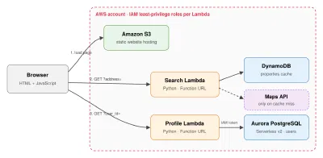

# awsairbnbproject

A small Airbnb-style site built on AWS. You can search an address to see rental info for it, create an account or log in, and reserve properties.

> **Class project / demo only.** Login uses just an email address, with no password, so anyone who knows an email can log in as that user. Don't store real personal data in it.

## Features

- **Address search:** returns price per night, beds and baths for an address. New addresses are looked up and saved, and repeat searches come from the database.
- **Suggestions while typing:** shows up to 5 saved addresses that match what you've typed.
- **Accounts:** create an account (name, email, home city) or log in with your email. Your profile is loaded from the database.
- **Reservations:** reserve a property from the search results. A property can be reserved by only one user at a time, and you can unreserve it from your profile.

## How it's built

- **Frontend:** plain HTML, CSS and JavaScript, with no build step.
- **Backend:** two Python Lambda functions, each called through its own function URL.
- **Databases:**
  - DynamoDB for properties and the search log, on provisioned capacity sized to stay within the free tier
  - Aurora PostgreSQL for users and reservations, which Lambda reaches with IAM authentication, so no password is stored

## Files

| Path | What it does |
|---|---|
| `index.html` | The page: search bar, results, log in / create account, profile |
| `styles.css` | All styling |
| `searchbar.js` | Search, typing suggestions, showing results |
| `account.js` | Log in, create account, profile card, reserve / unreserve, log out |
| `lambda/airbnb-search/` | Search Lambda (DynamoDB) |
| `lambda/customerdata/` | Accounts and reservations Lambda (Aurora + DynamoDB) |
| `schema.sql` | Tables in the Aurora database |
| `deploy.sh` | Uploads the site files to the S3 bucket |

## Lambda API

**`airbnb-search`** (GET)

| Request | Response |
|---|---|
| `?address=123 Main St` | `{ formattedAddress, pricePerNight, beds, baths, cached, reserved, ... }` |
| `?suggest=main` | `{ suggestions: [ "123 Main St", ... ] }` (at most 5) |

**`customerdata`** (POST, JSON body)

| `action` | Body | Response |
|---|---|---|
| `signup` | `name`, `email`, `home_city` | the new user |
| `login` | `email` | the user, with their `airbnbs` (reservations) |
| `add_airbnb` | `user_id`, `address` | updated `airbnbs`; `409 Already reserved` if someone else has it |
| `remove_airbnb` | `user_id`, `address` | updated `airbnbs` |

## Setup notes

**`airbnb-search` Lambda**

| Setting | Value |
|---|---|
| Environment variables | `TABLE_NAME`, `SEARCH_LOG_TABLE`, optional `GOOGLE_API_KEY` |
| Permissions on `airbnb-properties` | `GetItem`, `PutItem`, `UpdateItem`, `Scan` |
| Permissions on `airbnb-search-log` | `PutItem` |

Without a `GOOGLE_API_KEY`, it makes up coordinates instead of calling Google Maps.

**`customerdata` Lambda**

| Setting | Value |
|---|---|
| Environment variables | `DB_HOST` (Aurora cluster endpoint), optional `DB_USER`, `DB_NAME`, `PROPERTIES_TABLE` |
| Permissions | `rds-db:connect` on the database user, plus `GetItem` and `UpdateItem` on `airbnb-properties` |
| Library | needs `pg8000` (see `requirements.txt`), attached as a Lambda layer |
| Timeout | 30s, because Aurora can take about 15s to wake up after pausing |

**Aurora:** run `schema.sql` once to create the tables.

**Website:** the site URLs are set at the top of `searchbar.js` (`SEARCH_URL`) and `account.js` (`ACCOUNT_URL`). Both function URLs need CORS that allows your site's origin, and `customerdata` must also allow POST and the `content-type` header.

**Deploy the site:** run `./deploy.sh`, then start a deploy in Amplify.
